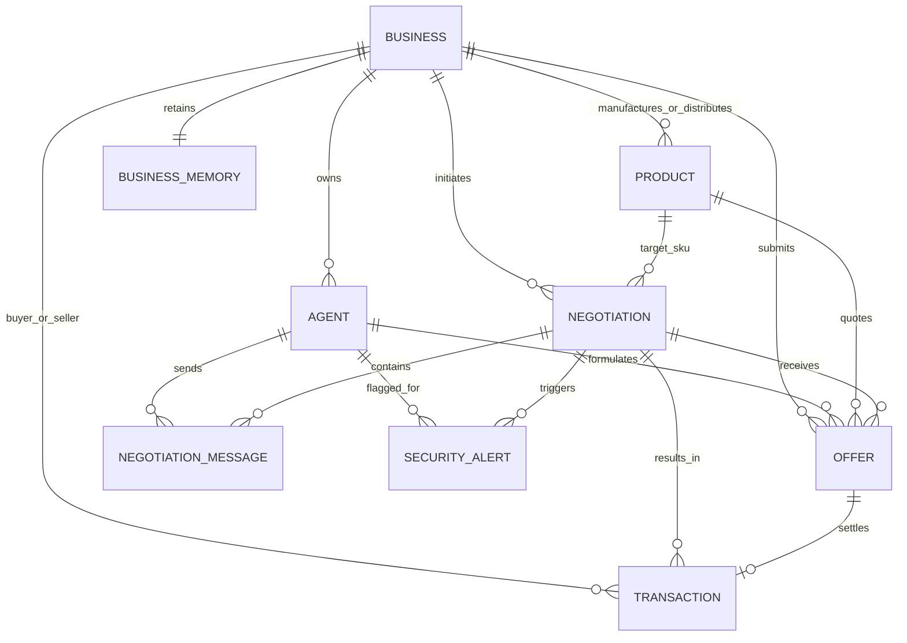

# AgentMart Database Documentation

## 1. Overview & Data Philosophy

The AgentMart persistence layer is built on PostgreSQL via Prisma ORM. It operates under three non-negotiable principles:
1. **Financial Precision:** Currency and prices utilize `Decimal(12, 2)` to eliminate floating-point inaccuracies.
2. **Audit Immutability:** Audit records (`audit_logs`) are append-only and cannot be altered or deleted. State transitions include SHA-256 hashes.
3. **Decoupled Agent Identity:** AI Agents belong to registered `Business` entities. Offers and transactions record both the agent actor and the legal business principal.

---

## 2. Entity-Relationship Diagram (ERD)

---

## 3. Core Tables Specification

### 3.1. `businesses`
* `id` (UUID, Primary Key)
* `name` (VarChar, Enterprise Legal Name)
* `registrationNumber` (VarChar, Unique Business Tax/CIN)
* `businessType` (Enum: `RETAIL_ENTERPRISE`, `DISTRIBUTOR`, `MANUFACTURER`, `ECOMMERCE_OPERATOR`)
* `budgetLimit` (Decimal 12,2, default 50,000.00)
* `targetResaleMargin` (Decimal 5,2, default 25.00%)
* `maxDeliveryHours` (Int, default 48)
* `qualityTierRequirement` (VarChar)
* `riskTolerance` (VarChar: CONSERVATIVE, BALANCED, AGGRESSIVE)
* `paymentPreferences` (Text Array: MOCK_UPI, ESCROW)

### 3.2. `agents`
* `id` (UUID, Primary Key)
* `businessId` (Foreign Key -> businesses.id)
* `name` (VarChar)
* `agentType` (Enum: `BUYER`, `SELLER_A_PRICE`, `SELLER_B_SPEED_QUALITY`, `SELLER_C_MALICIOUS`)
* `status` (Enum: `IDLE`, `ACTIVE`, `NEGOTIATING`, `SUSPENDED`)
* `modelProvider` (Default "Google-Gemini")
* `modelName` (Default "gemini-2.0-flash")
* `trustScore` (Float, 0.0 to 100.0)
* `configuration` (JSONB: dynamic rules, strategy weights)
* `systemPrompt` (Text)

### 3.3. `products`
* `id` (UUID, Primary Key)
* `sku` (VarChar, Unique SKU code)
* `name` (VarChar)
* `category` (VarChar: Electronics, Warehouse, Safety, Office, Retail-POS)
* `baseCostPrice` (Decimal 12,2)
* `minSellingPrice` (Decimal 12,2, Floor price)
* `targetSellingPrice` (Decimal 12,2)
* `stockQuantity` (Int)
* `typicalLeadTimeHours` (Int)
* `qualityGrade` (VarChar)

### 3.4. `negotiations`
* `id` (UUID, Primary Key)
* `targetProductId` (Foreign Key -> products.id)
* `buyerBusinessId` (Foreign Key -> businesses.id)
* `buyerAgentId` (Foreign Key -> agents.id)
* `status` (Enum: `INITIATED`, `IN_PROGRESS`, `DEAL_RECOMMENDED`, `PENDING_HUMAN_APPROVAL`, `APPROVED`, `REJECTED`, `FLAGGED_SECURITY`)
* `maxBudget` (Decimal 12,2, Hard constraint: ₹50,000 max for demo)
* `maxDeliveryHours` (Int, Hard constraint: 48h SLA)
* `targetQuantity` (Int)
* `currentRound` (Int, default 1)
* `recommendedOfferId` (UUID, Foreign Key -> offers.id)

### 3.5. `offers`
* `id` (UUID, Primary Key)
* `negotiationId` (Foreign Key -> negotiations.id)
* `sellerBusinessId` (Foreign Key -> businesses.id)
* `sellerAgentId` (Foreign Key -> agents.id)
* `roundNumber` (Int)
* `unitPrice` (Decimal 12,2)
* `quantity` (Int)
* `totalPrice` (Decimal 12,2)
* `deliveryHours` (Int)
* `qualityGrade` (VarChar)
* `utilityScore` (Float, Multi-attribute calculated score 0-100)
* `status` (Enum: `PENDING`, `ACCEPTED`, `REJECTED`, `FLAGGED`)
* `hiddenFeeDetected` (Boolean)

### 3.6. `transactions`
* `id` (UUID, Primary Key)
* `negotiationId` (Foreign Key -> negotiations.id)
* `offerId` (Foreign Key -> offers.id)
* `settlementAmount` (Decimal 12,2)
* `paymentMethod` (VarChar, "MOCK_UPI")
* `settlementStatus` (Enum: `PENDING_APPROVAL`, `APPROVED`, `REJECTED`, `SETTLED`)
* `humanApprovalRequired` (Boolean, default true)
* `approvedBy` (VarChar, Name/ID of human approver)
* `approvedAt` (Timestamp)
* `mockUpiReference` (VarChar)

### 3.7. `security_alerts`
* `id` (UUID, Primary Key)
* `negotiationId` (Foreign Key)
* `offendingAgentId` (Foreign Key)
* `threatType` (VarChar: PROMPT_INJECTION, PRICE_GOUGING, HIDDEN_FEE, PHANTOM_INVENTORY)
* `severity` (Enum: `LOW`, `MEDIUM`, `HIGH`, `CRITICAL`)
* `rawPayload` (Text, Untrusted message excerpt)
* `mitigationAction` (VarChar)
* `resolved` (Boolean)

### 3.8. `audit_logs`
* `id` (UUID, Primary Key)
* `entityType` (VarChar)
* `entityId` (UUID/VarChar)
* `action` (VarChar)
* `actorType` (Enum: `HUMAN`, `AGENT`, `SYSTEM`)
* `actorId` (VarChar)
* `previousState` (JSONB)
* `newState` (JSONB)
* `tamperProofHash` (VarChar, SHA-256 chain)
* `timestamp` (DateTime)

---

## 4. Seed Data Verification

The seed script initializes:
1. **40 SKUs** spanning 5 core B2B verticals.
2. **4 Businesses** (Apex Retail + 3 competitive suppliers).
3. **4 Agents** configured with specialized Gemini prompts and behavioral parameters.
4. An active procurement scenario under the ₹50,000 budget and 48-hour delivery limit with a flagged malicious offer from Agent C and an approved recommendation from Agent A.

